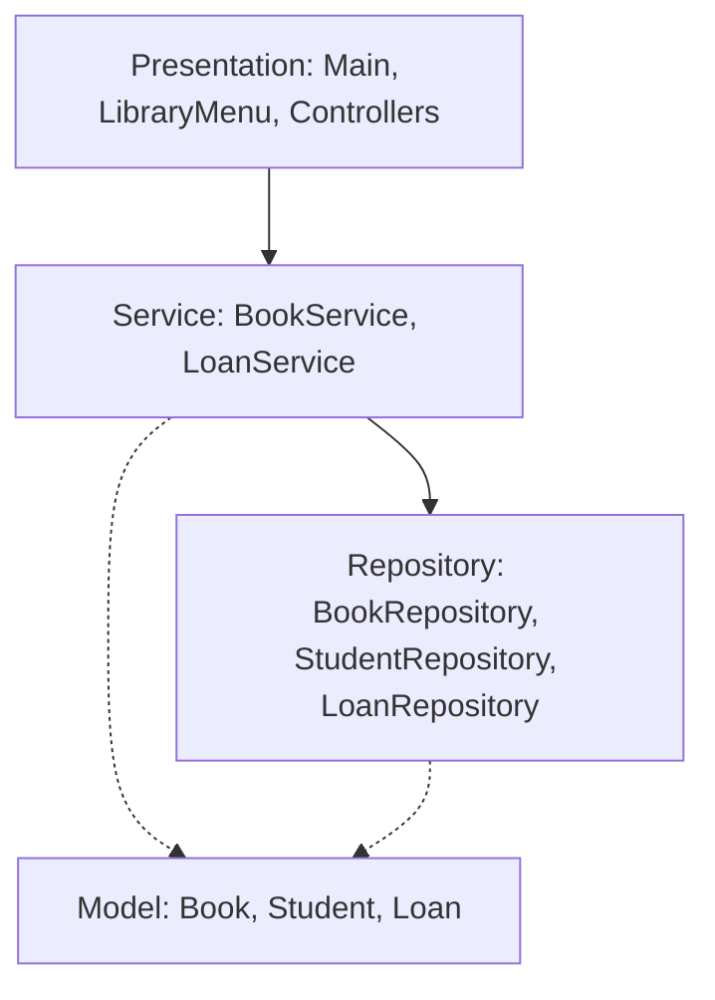

# Library Management System

Конзолно Java приложение за управление на училищна библиотека. Проектът е с трислойна архитектура.

## Функционалности
- Добавяне, редактиране, изтриване и търсене на книги по заглавие
- Списък на всички и на свободните книги
- Заемане и връщане на книги

## Бизнес правила
- Заглавието не може да е празно
- ISBN е уникален
- Заета книга не може да се заема, нито да се изтрива
- Един ученик има най-много 3 невърнати книги

## Архитектура

- **presentation** – вход и изход през конзолата, без бизнес правила
- **service** – проверки и бизнес правила
- **repository** – съхранение в паметта (ArrayList)
- **model** – Book, Student, Loan

## Структура на проекта
(постави дървото на папките от IntelliJ)

## Как се стартира
1. Нужна е Java (JDK 17 или по-нова)
2. Отвори проекта в IntelliJ IDEA
3. Стартирай `Main` от пакета `presentation`

При старт се зареждат три ученика с ID 1, 2 и 3.

## Тестове
JUnit 5. Десен бутон върху папката `test` → Run 'All Tests'. Тестват се сървисите с fake репозитории, без реална база.

## Автор
Твоето име